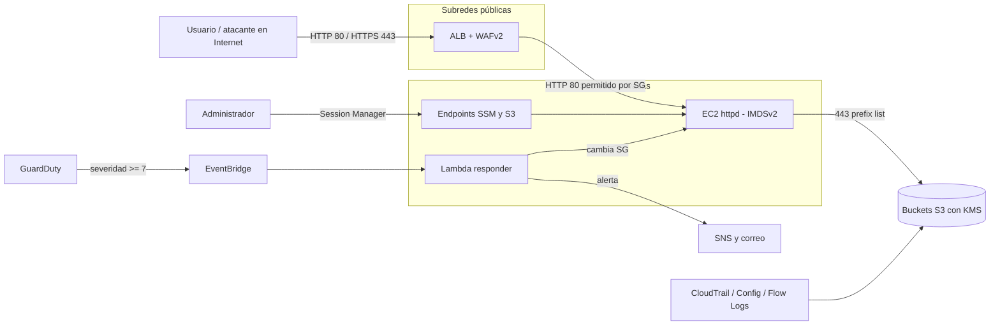

# Threat Model — Zero Trust en AWS (Proyecto 08)

| Campo | Valor |
| ----- | ----- |
| Sistema | Laboratorio `zero-trust-lab` (Terraform, AWS, región `us-east-2`) |
| Metodología | STRIDE sobre diagrama de flujo de datos, más evaluación contra los pilares de Zero Trust |
| Equipo | Firmes por Palmer |
| Versión | 1.0 |
| Ubicación sugerida | `docs/threat-model.md` |
| Documento relacionado | `runbook.md` |

> **Alcance de la evidencia.** El análisis se hizo **leyendo el código** del repositorio (Terraform, Lambda, workflows de CI y README). No se desplegó nada ni se ejecutó Checkov. Cada hallazgo indica su nivel de confianza:
> - **[C] Confirmado** en el código.
> - **[V] Por validar**: se infiere del código, pero depende del comportamiento de AWS y debe comprobarse en un despliegue real.

---

## 1. Resumen ejecutivo

El laboratorio aplica buenas prácticas de base: instancia privada sin IP pública, IMDSv2 obligatorio, acceso solo por Session Manager, WAF con reglas gestionadas, cifrado KMS con rotación, CloudTrail multi-región con validación de integridad, GuardDuty, Security Hub, Config y una respuesta automática que aísla instancias comprometidas.

Los riesgos más relevantes **no están en lo que falta por configurar en el perímetro, sino en tres brechas de operación y de diseño**:

1. **La respuesta automática probablemente no funciona con la configuración por defecto [V].** La Lambda corre en subredes privadas con un SG sin salida y no hay ruta hacia las APIs de EC2 ni de SNS (sin NAT, sin endpoints). El control estrella del proyecto podría fallar en silencio.
2. **La capa de identidad humana está fuera del código [C].** No hay usuarios, roles, SSO ni MFA definidos; el MFA del usuario raíz solo se *detecta* con una regla de Config, y no hay alarmas sobre uso del root o inicios de sesión sin MFA. En AWS, el compromiso de credenciales es el vector de mayor impacto.
3. **Visibilidad incompleta y controles debilitados por excepciones [C].** No hay registro de peticiones del WAF ni del ALB, ni registro del contenido de las sesiones de Session Manager. El bloqueo de acceso público de S3 se relajó **a nivel de cuenta** para resolver un problema de entrega de logs cuya justificación es dudosa.

Además hay un defecto funcional que afecta la demostración: el target group del ALB apunta al puerto 443 con HTTPS, mientras la instancia solo sirve HTTP en el 80 **[C]**.

### Top 10 riesgos priorizados

| # | Riesgo | Nivel | Esfuerzo de corrección |
|---|--------|-------|------------------------|
| 1 | Responder sin ruta a las APIs de EC2/SNS (T-DoS-03) | **Alto** | Bajo |
| 2 | Compromiso de credenciales humanas / root sin alarmas (T-S-01) | **Alto** | Medio |
| 3 | Bloqueo de acceso público de S3 relajado a nivel de cuenta y en el bucket de logs (T-T-05) | **Alto** | Bajo |
| 4 | Sin registro de WAF, ALB ni sesiones SSM: no repudio débil (T-R-01) | **Alto** | Medio |
| 5 | Los logs pueden ser alterados o borrados por un administrador (T-T-01) | **Medio-alto** | Medio |
| 6 | Rol de la Lambda con permisos amplios sobre EC2 (T-E-01) | **Medio** | Bajo |
| 7 | Sin autenticación en la aplicación expuesta; sin HTTPS por defecto (T-S-02 / T-S-04) | **Medio** | Medio |
| 8 | Instancia única en una AZ y sin gestión de parches (T-DoS-01) | **Medio** | Medio |
| 9 | Replicación de logs probablemente no operativa; bucle de logs y avalancha de alertas (T-DoS-02) | **Medio** | Bajo |
| 10 | Estado de Terraform local, `.lock.hcl` ignorado y CI sin plan/apply (T-T-02) | **Medio** | Bajo |

## 2. Alcance, supuestos y exclusiones

**Dentro del alcance:** todo lo que define `terraform/`, la Lambda `responder.py`, los workflows de GitHub Actions y la configuración del repositorio.

**Supuestos:**

- Cuenta de laboratorio única (AWS Academy), sin AWS Organizations ni SCP.
- La aplicación es una página estática de demostración; **no maneja datos sensibles de negocio**. Lo que se protege es la propia infraestructura, los logs de auditoría y la cuenta.
- Quien ejecuta Terraform tiene privilegios de administrador.

**Fuera del alcance:** seguridad física de AWS, seguridad del equipo del desarrollador, contenido de una aplicación real, y cuentas de GitHub (se mencionan solo como superficie de la cadena de suministro).

## 3. Activos

| ID | Activo | Por qué importa | Dónde |
| -- | ------ | --------------- | ----- |
| A1 | Cuenta AWS y sus credenciales (root, administradores, claves) | Control total de todo | Fuera de IaC |
| A2 | Registros de auditoría: CloudTrail, Config, flow logs | Evidencia forense y de cumplimiento | `s3.tf`, `cloudtrail.tf`, `logging.tf` |
| A3 | Claves KMS (`s3`, `cloudtrail`, `cw-logs`, `lambda`) | Sin ellas los logs son ilegibles | varios |
| A4 | Instancia EC2 y su rol de instancia | Superficie de ejecución de código | `compute.tf` |
| A5 | Lambda `responder` y su rol | Capacidad de contención automática | `incident_response.tf`, `roles.tf` |
| A6 | Canal de alertas (SNS + correo) | Sin él nadie se entera | `incident_response.tf` |
| A7 | Código Terraform, estado y CI | Define toda la infraestructura | repositorio |
| A8 | Presupuesto / disponibilidad del laboratorio | Impacto económico y académico | `budgets.tf` |

## 4. Arquitectura y fronteras de confianza

| Frontera | Cruce | Control existente |
| -------- | ----- | ----------------- |
| **F1** Internet → ALB | Tráfico no confiable hacia el único punto público | WAF (OWASP, SQLi, entradas maliciosas, reputación IP, rate limit); SG del ALB |
| **F2** ALB → EC2 | Subred pública a privada | SG de la app: solo el puerto 80 desde el SG del ALB; sin SSH |
| **F3** Plano de administración → EC2 | Operador a instancia | Session Manager por endpoints privados; sin IP pública |
| **F4** EC2 → servicios AWS | Salida de la instancia | SG: 443 solo hacia VPC y prefix list de S3; rol mínimo (`AmazonSSMManagedInstanceCore`) |
| **F5** Servicios de seguridad → almacenamiento | Entrega de logs | Políticas de bucket por servicio, KMS, versionado |
| **F6** Código/CI → cuenta AWS | Cambios de infraestructura | Checkov, `terraform validate`; `apply` manual |

## 5. Evaluación Zero Trust por pilar

| Pilar | Estado | Lo que existe | Lo que falta |
| ----- | ------ | ------------- | ------------ |
| **Identidad** | 🔴 Ausente en IaC | Política de contraseñas estricta (14+ caracteres); Config `root-account-mfa-enabled` (solo detecta) | IAM Identity Center/SSO, MFA obligatorio, roles de mínimo privilegio para humanos, alarmas de root/ConsoleLogin sin MFA, límites de permisos |
| **Dispositivo / carga** | 🟡 Parcial | IMDSv2, EBS cifrado, sin IP pública, sin SSH, rol mínimo | Gestión de parches (Patch Manager), Inspector, agente de monitoreo, registro de sesiones |
| **Red** | 🟢 Bueno | Subredes privadas, SG por referencia, endpoints privados, SG por defecto vaciado, flow logs | NACLs, política en el endpoint de S3, filtrado de salida más fino, mismo aislamiento para la Lambda |
| **Aplicación** | 🟡 Parcial | WAF con 4 grupos gestionados y rate limit; `drop_invalid_header_fields` | Autenticación en el borde (OIDC/Cognito), HTTPS efectivo por defecto, política TLS moderna, registro del WAF |
| **Datos** | 🟡 Parcial | KMS con rotación, versionado, TLS obligatorio en buckets (`aws:SecureTransport`), replicación | Object Lock / protección contra borrado, separación de claves por dominio, replicación verificada |
| **Visibilidad y automatización** | 🟡 Parcial | CloudTrail, Config, GuardDuty, Security Hub, Access Analyzer, responder | Alarmas y filtros de métricas, enrutamiento de severidad media, notificación de Config/Security Hub, automatización probada |

## 6. Análisis STRIDE

**Escala.** *Probabilidad* y *Impacto*: B = baja, M = media, A = alta. *Riesgo residual* = riesgo que queda considerando los controles existentes.

### 6.1 Suplantación (Spoofing)

| ID | Amenaza | Controles existentes | Prob. | Imp. | Residual | Mitigación recomendada |
| -- | ------- | -------------------- | :---: | :--: | :------: | ---------------------- |
| **T-S-01** | Robo o phishing de credenciales de consola/CLI o del usuario raíz; uso de claves de acceso filtradas **[C]** | Política de contraseñas; regla Config de MFA raíz (detectiva); GuardDuty | M | A | **Alto** | SSO + MFA obligatorio, sin claves de larga duración; alarma de CloudWatch ante `root` y `ConsoleLogin` sin MFA; revisar `iam:*` con Access Analyzer |
| **T-S-02** | Cualquier persona puede alcanzar la aplicación: no hay autenticación en el borde **[C]** | WAF; SG | A | B | **Medio** | Para una app real, autenticar en el ALB (OIDC/Cognito). Para la demo, documentarlo como riesgo aceptado |
| **T-S-03** | Robo de credenciales del rol de instancia vía SSRF o metadatos | IMDSv2 obligatorio, `hop_limit = 1`, rol solo con SSM Core **[C]** | B | M | **Bajo** | Mantener; no añadir permisos al rol sin revisión |
| **T-S-04** | Intermediario o *downgrade*: por defecto no hay listener HTTPS; el HTTP redirige a un 443 sin servicio. Política TLS `ELBSecurityPolicy-TLS-1-2-2017-01` antigua **[C]** | Redirección 301 configurada | M | M | **Medio** | Activar ACM con validación DNS y política TLS 1.2/1.3 moderna (ver `runbook.md` 6.4) |

### 6.2 Manipulación (Tampering)

| ID | Amenaza | Controles existentes | Prob. | Imp. | Residual | Mitigación recomendada |
| -- | ------- | -------------------- | :---: | :--: | :------: | ---------------------- |
| **T-T-01** | Un administrador comprometido borra o altera logs, detiene CloudTrail o programa el borrado de claves KMS | Validación de integridad de CloudTrail, versionado, replicación (probablemente inoperante, ver T-DoS-02), ventana de borrado KMS de 30 días **[C]** | M | A | **Medio-alto** | S3 Object Lock en el bucket de trail/logs; política de bucket que niegue `DeleteObject*` y `PutBucketPolicy` salvo a un rol dedicado; alarmas sobre `StopLogging`, `DeleteTrail`, `ScheduleKeyDeletion`, `DisableKey`; verificar la replicación; bucket de logs en otra cuenta si es posible |
| **T-T-02** | Cambios maliciosos o accidentales en el código y la cadena de suministro: estado local sin cifrado ni bloqueo, `*.terraform.lock.hcl` en `.gitignore` (versiones de providers no fijadas), providers `~> 5.0`, GitHub Actions fijadas por etiqueta y no por commit, el CI no ejecuta `plan` ni aplica revisiones **[C]** | Checkov, `validate`, `fmt`; `apply` manual | M | A | **Medio** | Backend remoto cifrado con bloqueo; versionar el lock file; fijar acciones por SHA; proteger la rama principal con revisión obligatoria; `plan` en PR |
| **T-T-03** | Tomar control de la Lambda responder o desactivar su regla de EventBridge para "cegar" la respuesta | Lambda con rol propio; permisos de invocación acotados a la regla **[C]** | B | A | **Medio** | Alarma sobre `events:DisableRule`, `lambda:UpdateFunctionCode`; firma de código (hoy omitida por `CKV_AWS_272`) |
| **T-T-04** | Abrir puertos en un SG para exponer la instancia | Config `restricted-ssh` solo cubre SSH (`INCOMING_SSH_DISABLED`); Security Hub FSBP **[C]** | M | M | **Medio** | Añadir reglas de Config para puertos comunes abiertos a `0.0.0.0/0` y alarmas sobre `AuthorizeSecurityGroupIngress` |
| **T-T-05** | **Exposición de datos de logs por políticas públicas**: `block_public_policy=false` y `restrict_public_buckets=false` en el bucket de logs **y en el bloqueo a nivel de cuenta** (afecta a todos los buckets de la cuenta) **[C]** | `block_public_acls` e `ignore_public_acls` siguen activos; la política del bucket usa condiciones por servicio y cuenta | M | A | **Alto** | Reactivar los dos bloqueos y **probar** la entrega de logs: las políticas de bucket concedidas a un *principal de servicio* con condiciones (`aws:SourceAccount`, `aws:SourceArn`) no se consideran públicas, así que la justificación de las excepciones `CKV_AWS_54/56`/`CKV2_AWS_6` probablemente es innecesaria **[V]** |
| **T-T-06** | Inyección web (SQLi, XSS, entradas maliciosas) hacia la aplicación | WAF: Common, SQLi, KnownBadInputs, IpReputation; sin código dinámico en la instancia **[C]** | B | B | **Bajo** | Mantener; revisar las reglas al desplegar una aplicación real |

### 6.3 Repudio (Repudiation)

| ID | Amenaza | Controles existentes | Prob. | Imp. | Residual | Mitigación recomendada |
| -- | ------- | -------------------- | :---: | :--: | :------: | ---------------------- |
| **T-R-01** | No se puede atribuir ni reconstruir la actividad: sin logs de acceso del ALB, sin registro del WAF, sin registro del contenido de sesiones de Session Manager **[C]** | CloudTrail (eventos de administración), flow logs | A | M | **Alto** | Reactivar `access_logs` del ALB; registro del WAF (Firehose/S3/CloudWatch); preferencias de Session Manager con registro a S3/CloudWatch cifrado con KMS |
| **T-R-02** | Eventos de datos de S3 no registrados en CloudTrail (solo eventos de administración) | GuardDuty S3 Protection analiza eventos de datos de forma independiente **[C]** | M | M | **Medio** | Habilitar eventos de datos solo para los buckets de logs/trail (costo moderado) |
| **T-R-03** | Las acciones del rol de la Lambda y los cambios del responder no dejan una traza distinta de los logs de la función | Logs de la Lambda cifrados con KMS, retención 365 días **[C]** | B | B | **Bajo** | Etiquetar la instancia aislada para dejar rastro visible (`Estado=Aislada`) |

### 6.4 Divulgación de información (Information disclosure)

| ID | Amenaza | Controles existentes | Prob. | Imp. | Residual | Mitigación recomendada |
| -- | ------- | -------------------- | :---: | :--: | :------: | ---------------------- |
| **T-I-01** | Exfiltración desde una EC2 comprometida por el endpoint de S3 (sin política de endpoint) o por el canal 443 hacia la VPC | SG de salida restringido a VPC y prefix list de S3; el rol de la instancia no tiene permisos de S3 **[C]** | B | M | **Bajo** | Añadir política al endpoint de S3 limitada a los buckets del proyecto y repositorios de paquetes |
| **T-I-02** | Una sola clave KMS (`s3`) protege tres buckets de logs y su política delega todo a la cuenta raíz: cualquier IAM con permisos amplios puede leer los logs; sin separación de funciones **[C]** | Rotación automática; condiciones por servicio en las entradas de CloudTrail y flow logs | M | M | **Medio** | Claves separadas por dominio (trail, config, flow logs); política de clave con administradores y usuarios diferenciados |
| **T-I-03** | La Lambda imprime el evento completo de GuardDuty (`print(json.dumps(event))`) y el correo incluye identificadores de instancia | Log group cifrado con KMS; el topic SNS está cifrado en reposo **[C]** | B | B | **Bajo** | Registrar solo los campos necesarios; el correo es un canal no cifrado de extremo a extremo |
| **T-I-04** | Filtración por el repositorio: estado local, `terraform.tfvars` (correo), y un `.gitignore` con un comando de shell pegado que revela una ruta local con un nombre de usuario **[C]** | `.gitignore` excluye `tfstate`, `tfvars`, `.pem`, `.key`, `.env` y `docs/evidencias/` | B | B | **Bajo** | Limpiar `.gitignore`; backend remoto; escaneo de secretos en CI |

### 6.5 Denegación de servicio (Denial of Service)

| ID | Amenaza | Controles existentes | Prob. | Imp. | Residual | Mitigación recomendada |
| -- | ------- | -------------------- | :---: | :--: | :------: | ---------------------- |
| **T-DoS-01** | Caída por inundación L7 o por fallo de la única instancia en una sola AZ (`subnet = private[0]`); sin Auto Scaling ni parches **[C]** | WAF con límite de 2000 solicitudes / 5 min por IP; ALB en dos AZ | M | M | **Medio** | Auto Scaling Group en dos AZ; Patch Manager; AWS Shield Standard ya está incluido, evaluar Advanced solo si hay presupuesto |
| **T-DoS-02** | **Alertas y costos desbordados:** cada objeto creado en los buckets de réplica, config y trail dispara un correo; el bucket de destino escribe sus logs al bucket de logs, que se replica al destino (bucle); la replicación de objetos SSE-KMS probablemente no está configurada correctamente **[C]/[V]** | Presupuestos al 50 % y 100 % del gasto real | A | M | **Medio** | Quitar notificaciones de `ObjectCreated:*` o filtrarlas; excluir el prefijo `s3-access/` de la replicación; configurar `source_selection_criteria` y la clave de destino de KMS; añadir alerta de gasto pronosticado |
| **T-DoS-03** | **Pérdida de la capacidad de respuesta:** la Lambda en la VPC no puede alcanzar las APIs de EC2 ni de SNS (sin NAT, sin endpoints de `ec2` ni `sns`, SG sin salida); no reserva concurrencia (`CKV_AWS_115`); solo actúa sobre severidad ≥ 7 **[C]/[V]** | DLQ en SNS; logs; excepciones documentadas | A | A | **Alto** | Crear endpoints de interfaz `ec2` y `sns` con SG de salida 443 para la Lambda, o sacarla de la VPC; **prueba obligatoria** (`runbook.md` 7.2); alarma sobre errores/timeouts de la función |
| **T-DoS-04** | Eliminación o deshabilitación de claves KMS: logs ilegibles y servicios que fallan | Ventana de borrado de 30 días, rotación activa **[C]** | B | A | **Medio** | Alarma sobre `ScheduleKeyDeletion`/`DisableKey`; política que restrinja esas acciones a un rol dedicado |
| **T-DoS-05** | Consumo de presupuesto por servicios activados por defecto (GuardDuty, Config, endpoints, NAT, WAF) | Banderas de costo; presupuesto | M | B | **Bajo** | Revisión mensual; destruir al terminar (`runbook.md` sección 9) |

### 6.6 Elevación de privilegios (Elevation of privilege)

| ID | Amenaza | Controles existentes | Prob. | Imp. | Residual | Mitigación recomendada |
| -- | ------- | -------------------- | :---: | :--: | :------: | ---------------------- |
| **T-E-01** | **El rol de la Lambda es más amplio de lo necesario:** `ec2:ModifyInstanceAttribute` sobre `instance/*` sin condiciones (puede cambiar los SG de cualquier instancia a cualquier SG) y `ec2:*NetworkInterface` sobre `*` (borrar ENIs ajenas, incluidas las del ALB o de los endpoints) **[C]** | Excepciones documentadas `CKV_AWS_355/290` | B | M | **Medio** | Condición por etiqueta `Project`; `ec2:ModifyInstanceAttribute` limitado a instancias del proyecto; si se saca la Lambda de la VPC, desaparecen los permisos de ENI |
| **T-E-02** | Quien tenga `ssm:StartSession` obtiene un shell con privilegios de `sudo` en la instancia; no hay restricción por etiqueta ni registro de sesión **[C]** | Sin SSH; solo Session Manager | B | M | **Medio** | Política IAM que limite `StartSession` por etiqueta y exija registro; usuarios con sesión temporal |
| **T-E-03** | Las políticas de clave delegan toda la administración a la raíz de la cuenta: cualquier principal con `kms:*` en IAM administra las claves **[C]** | Rotación; condiciones por servicio | B | M | **Medio** | Separar administradores y usuarios de claves; alarmas sobre cambios de política |
| **T-E-04** | Efectos a nivel de cuenta: política de contraseñas, cifrado EBS por defecto, bloqueo de snapshots, bloqueo S3 relajado; cualquier carga de la cuenta se ve afectada, y también al destruir **[C]** | Documentado en el código | M | M | **Medio** | Usar una cuenta dedicada; documentar el impacto antes de aplicar o destruir |
| **T-E-05** | El `apply` se ejecuta con una identidad administradora local sin revisión ni *break-glass* definido **[C]** | `apply` manual | B | A | **Medio** | Rol de despliegue con permisos acotados; OIDC desde GitHub Actions con aprobación manual |

## 7. Controles verificados que funcionan como defensa en profundidad

Los siguientes controles están bien diseñados y deben **mantenerse** **[C]**:

- Instancia sin IP pública, en subred privada, con IMDSv2 (`http_tokens = required`, `hop_limit = 1`) y disco cifrado.
- Un solo ingreso desde Internet (ALB); el SG de la app solo acepta tráfico del SG del ALB; sin SSH.
- SG por defecto de la VPC sin reglas; SG vacío preparado para aislamiento.
- Endpoints privados para SSM y puerta de enlace para S3; sin NAT salvo autorización.
- Bucket de trail, config y logs con TLS obligatorio, versionado y cifrado KMS; CloudTrail con validación de integridad y multi-región.
- Cifrado de CloudWatch Logs con KMS y retención de 365 días.
- Cifrado EBS por defecto, bloqueo de compartición pública de snapshots y de documentos SSM.
- Respuesta automática diseñada (EventBridge → Lambda → SNS) y presupuesto con alertas.

## 8. Riesgos aceptados documentados en el README

El README lista 15 excepciones de Checkov. Se evaluaron así:

| Excepción | Evaluación | Recomendación |
| --------- | ---------- | ------------- |
| `CKV_AWS_54`, `CKV_AWS_56`, `CKV2_AWS_6` (bloqueo público S3) | **Cuestionable**: probablemente innecesaria; ver T-T-05 | Reactivar y probar |
| `CKV_AWS_91` (logs del ALB) | **Cuestionable**: el motivo es un error transitorio | Reactivar tras el primer `apply` |
| `CKV2_AWS_31` (registro del WAF) | **Aceptable en laboratorio**, pero afecta la trazabilidad | Implementar destino de logs |
| `CKV_AWS_173` (KMS en variables de entorno de la Lambda) | **Revisar**: `kms_key_arn` es un argumento propio de `aws_lambda_function` (no del bloque `environment`), por lo que el motivo parece incorrecto **[V]** | Volver a intentar con el argumento de nivel de recurso |
| `CKV_AWS_272`, `CKV_AWS_115` (firma de código, concurrencia) | Aceptable en laboratorio | Revisar si cambia la cuota |
| `CKV_AWS_355`, `CKV_AWS_290` (permisos EC2 de la Lambda) | Aceptable solo por estar en la VPC; ver T-E-01 | Reducir al sacar la Lambda de la VPC |
| `CKV_AWS_260` (HTTP 80 público) | Aceptable si el redirect funciona; hoy no hay listener 443 | Ver T-S-04 |
| `CKV_AWS_252`, `CKV2_AWS_76`, `CKV2_AWS_3`, `CKV_AWS_394` | Aceptables | Mantener la justificación |

> **Matiz sobre `CKV2_AWS_76`:** la justificación cita Log4j y las reglas gestionadas `KnownBadInputs` e `IpReputation`; esas reglas ayudan, pero la regla de Log4j de Checkov espera específicamente el grupo que cubre ese patrón. Es válido como excepción, aunque conviene confirmarlo en la consola.

## 9. Plan de mitigación sugerido

### Fase 1 — Corregir de inmediato (bajo esfuerzo, alto valor)

1. Dar a la Lambda salida hacia EC2 y SNS (endpoints o sacarla de la VPC) y **probar el responder** (`runbook.md` 7.2).
2. Corregir el target group (HTTP 80) para que el ALB funcione.
3. Reactivar `block_public_policy` y `restrict_public_buckets` (cuenta y bucket de logs) y verificar la entrega de logs.
4. Confirmar la suscripción de SNS y reducir las notificaciones de S3.
5. Limpiar el `.gitignore`.

### Fase 2 — Visibilidad y detección

6. Reactivar logs del ALB; añadir registro del WAF; registro de Session Manager.
7. Filtros de métricas y alarmas: root, `ConsoleLogin` sin MFA, `StopLogging`, `DeleteTrail`, `ScheduleKeyDeletion`, cambios de SG/IAM/políticas de bucket, `DisableRule`.
8. Enrutar a SNS también los hallazgos de GuardDuty de severidad media y los cambios de cumplimiento de Config/Security Hub.

### Fase 3 — Endurecimiento

9. Object Lock y política de denegación de borrado en logs; separar claves KMS; verificar replicación.
10. Acotar el rol de la Lambda; política en el endpoint de S3; restringir `StartSession` por etiqueta.
11. Backend remoto con bloqueo, lock file versionado, acciones por SHA, `plan` en PR y despliegue con OIDC.
12. ASG en dos AZ y Patch Manager.
13. HTTPS efectivo con ACM y política TLS moderna; autenticación en el borde si hay una aplicación real.

## 10. Lagunas a validar en un despliegue real

| Qué comprobar | Cómo |
| ------------- | ---- |
| La Lambda aísla la instancia y envía el correo | `runbook.md` 7.2 |
| El target del ALB queda sano | `aws elbv2 describe-target-health` |
| La replicación copia los objetos cifrados con KMS | `aws s3api get-bucket-replication` y comparar objetos |
| La entrega de logs funciona con los bloqueos de acceso público reactivados | Reaplicar con `block_public_policy=true` en un entorno de prueba |
| S3 puede publicar en un topic cifrado con `alias/aws/sns` | Revisar que `aws_s3_bucket_notification` se cree sin error |
| El estado de Checkov reportado en el README (236 / 15 / 0) | `checkov -d terraform --compact` |

## 11. Mantenimiento de este documento

Revisar este threat model cuando: se active HTTPS, se añada una aplicación real o una base de datos, cambien los permisos de la Lambda, se agreguen identidades humanas, se retire alguna excepción de Checkov, o cada 6 meses. Cada incidente cerrado (`runbook.md` 7.9) debe revisarse contra las amenazas de este documento y, si no estaba contemplado, añadirse como nueva fila.
